# 实验报告

**钟璟文 3200104696**

## 1.全球气候时空演变

### 1.1 长时序全球海表温度数据集的检索与可视化

逐个加载全球海表温度数据集。加载过程如下图所示

下图是1993年的海表温度数据

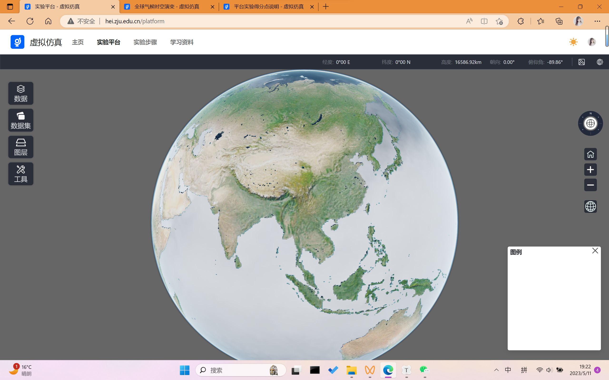

下图是2018年的海表温度数据

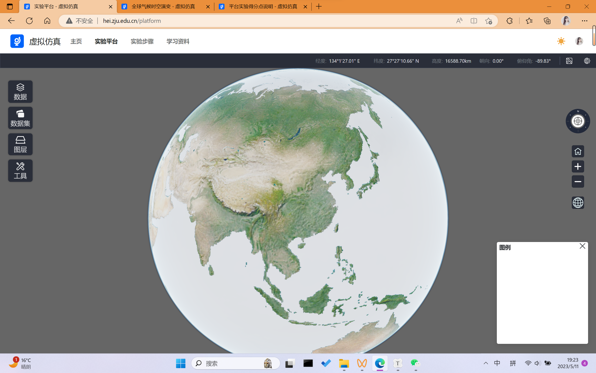

将这两个数据进行大致对比，可以发现，最近30年内，两极地区的海表温度变化较大，而低纬度地区的海表温度变化相对不大。

### 1.2 长时序全球海表温度时空演变过程模拟

使用【时序播放】功能，播放全球海表温度数据集，如下图所示

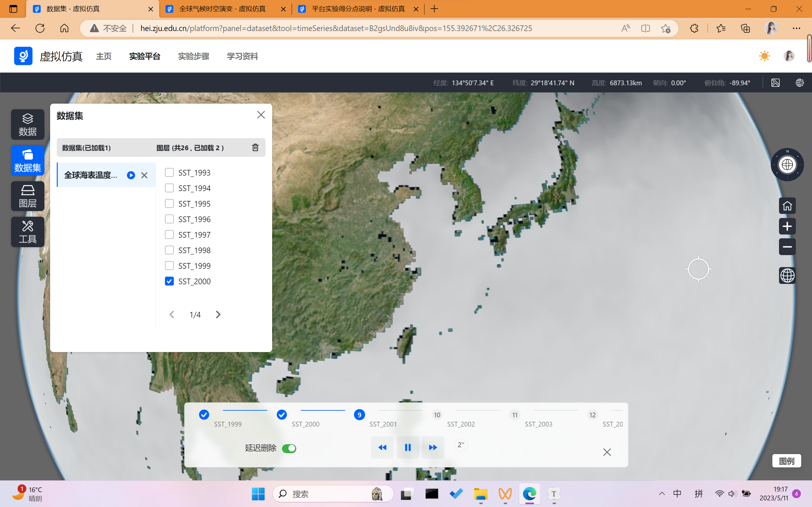

在整个数据集播放的过程中可以看到：

1. 最近30年内，全球海表温度普遍呈现上升趋势。

2. 在两极地区、寒流流经地区（例如北大西洋西岸）等海水温度普遍偏低的地区，海表温度的上升更加明显

在本实验的第3步将使用时间序列图表绘制进行验证。

### 1.3 长时序全球海表温度统计信息图表绘制

根据上述大致预测，现选取4个兴趣点，分别为：赤道太平洋地区，北冰洋地区，赤道印度洋地区，西北大西洋地区。

下图为赤道太平洋地区的海表温度时间序列图

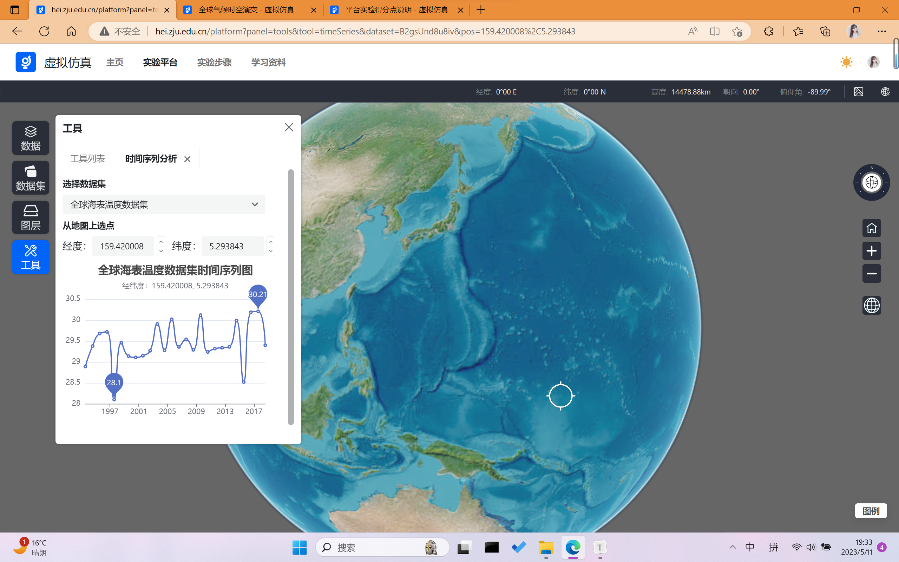

下图为赤道印度洋地区的海表温度时间序列图

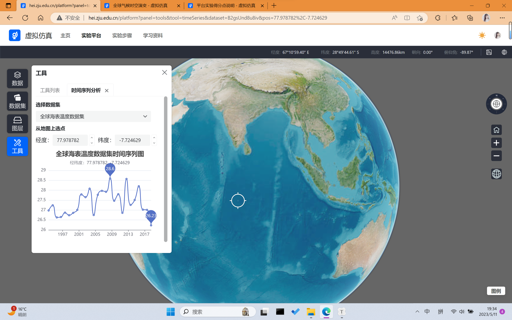

下图为西北大西洋地区的海表温度时间序列图

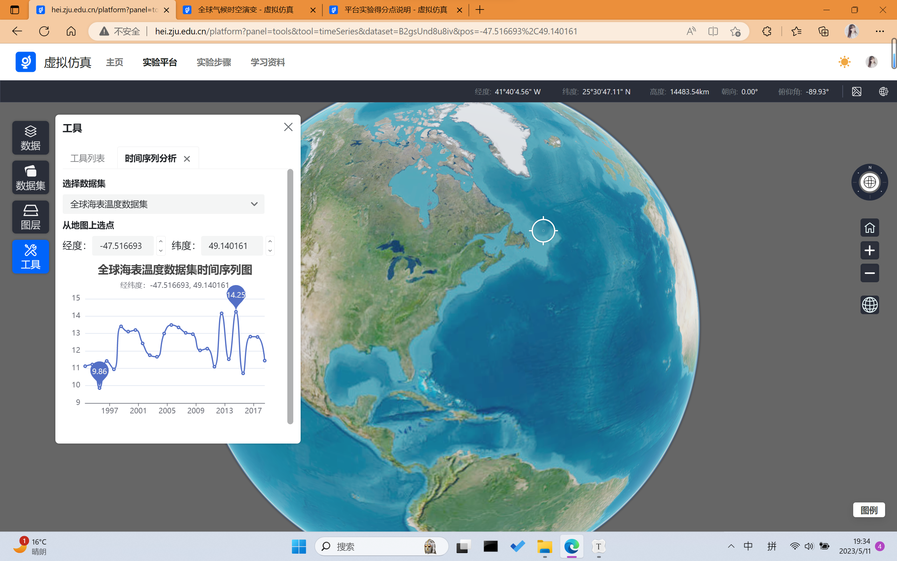

下图为北冰洋地区的海表温度时间序列图

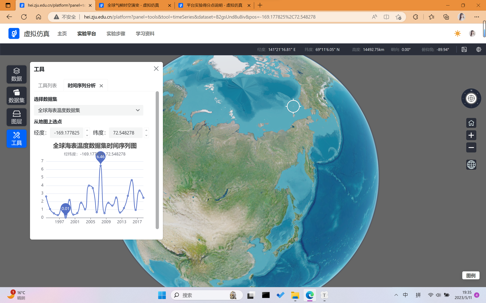

对照：这是中纬度太平洋地区的海表温度时间序列图

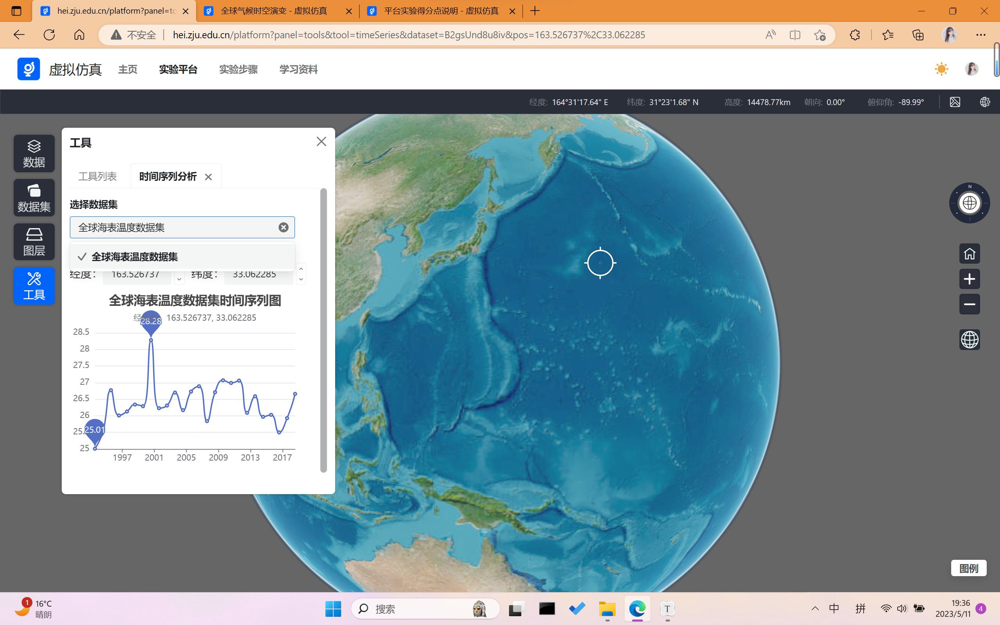

从上述时间序列图中，可以大致得出以下结论：

1. 最近30年，全球海表温度普遍呈现上升趋势。
2. 全球海表温度的上升幅度随纬度升高而增大。一般来说，低纬度和赤道地区上升1℃左右，中纬度地区上升1-2℃，高纬度地区上升超过2℃。
3. 全球海表温度的波动幅度在最近几年不断变大。
4. 对于寒流流经的区域，其变化模式和幅度会向高纬度靠近（升温幅度偏大）；对于暖流流经的区域，其变化模式和幅度会向低纬度靠近（升温幅度变小）。

可能的原因如下：

1. 全球气候变暖导致海表温度上升。其中，气候变暖对高纬度气温的影响更大，因此高纬度的海表温度上升幅度比低纬度大。
2. 全球气候变化导致极端天气发生的频率上升。酷热、寒潮等极端天气都会导致海表温度偏高或偏低，故最近几年海表温度波动幅度变大。
3. **数据显示，全球气候变暖导致北极地区的气温上升幅度为0.12℃/年。**但是，海表温度的上升幅度明显小于气温上升幅度。这可能是因为北冰洋的海冰融化会吸收热量，同时海水比热较大，导致海表温度的上升没有那么快。

## 2.海洋生态环境时空演变

### 2.1 长时序叶绿素浓度数据集检索和浏览

使用【时序播放】工具，加载叶绿素浓度数据如下图

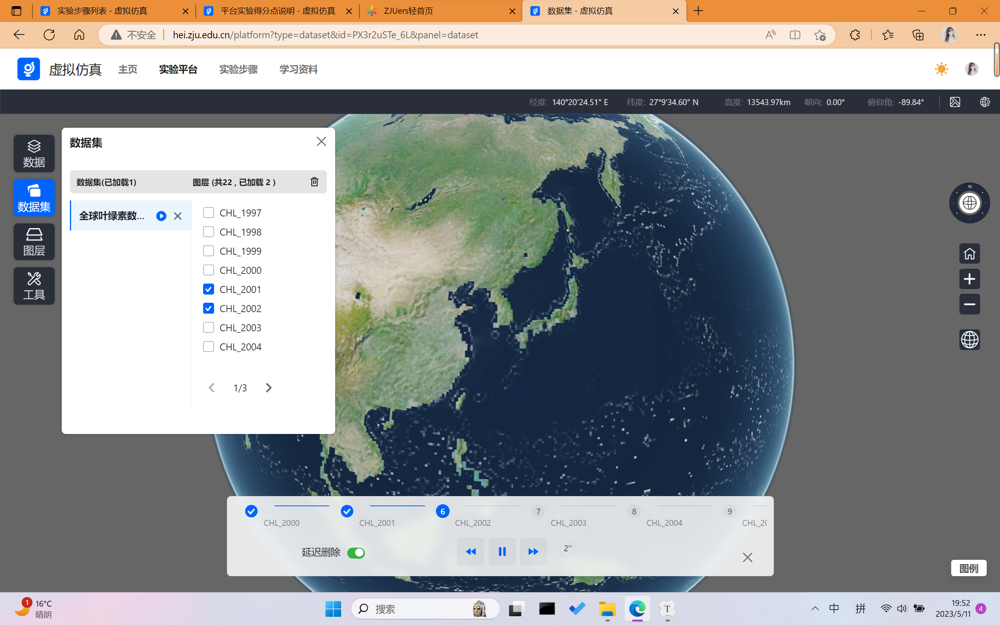

从时序变化图中可以看到叶绿素浓度变化大致具有如下趋势：

1. 近海岸地区的叶绿素浓度普遍较高，而大洋中部的叶绿素浓度普遍较低。这可能是受浮游生物的生长条件决定的，更多的浮游生物适合在近海岸地区和低纬度赤道地区生长，从而会产生更多的叶绿素。另外，部分寒流流经的地区和知名渔场的叶绿素浓度也普遍较高。
2. 全球海洋水体叶绿素浓度呈现先减少后增加的趋势。其中，近海岸地区、低纬度赤道地区的叶绿素浓度的变化幅度较小，而大洋中部地区和高纬度地区叶绿素浓度的变化幅度较大。这可能是因为大洋中部的浮游生物数量少且容易受到外界条件的影响。这种变化趋势推测与气候等方面的变化存在关联。

### 2.2 长时序水体透明度数据集检索和浏览

使用【时序播放】工具，加载全球海水透明度数据如下图

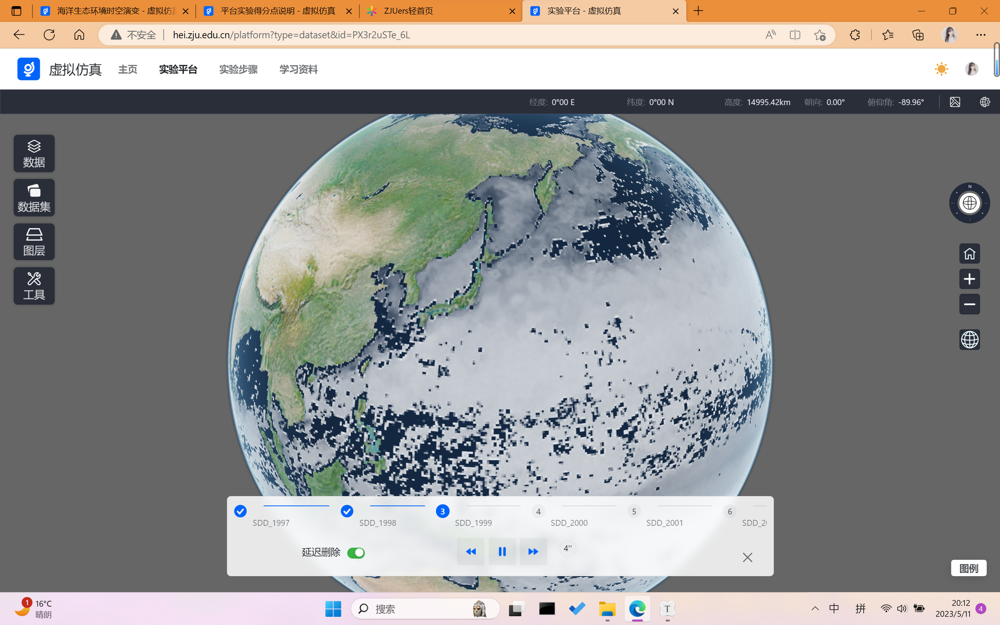

从时序变化图中可以看到全球水体透明度数据存在如下趋势：

1. 全球水体透明度总体呈现下降趋势。这可能是因为随着气候变化和水体富营养化加剧，水中的浮游生物数量不断变多，导致水体透明度下降。其中大洋中部的透明度下降幅度比较大，这可能是因为近岸地区本身就有较多营养物质，而气候变化对大洋中部生态环境的影响更大。
2. 全球水体透明度与叶绿素含量总体成反比，叶绿素含量高的区域透明度低。这是因为叶绿素含量高意味着浮游生物多，浮游生物多必然会导致水体透明度下降。
3. 极地海水的透明度高，这可能有两方面因素决定：（1）纬度高，水温低，浮游生物难以生长（2）海冰冻结和融化过程中对海水的净化作用
4. 北印度洋地区虽然接近大陆，但水体透明度反常的高，这可能是因为当地为热带沙漠气候，河流数量少，大陆上的生物多样性缺乏，难以携带有机质进入海洋，导致该区域海水养分数量不足。

### 2.3 长时序海洋生态环境评价

使用【海洋生态环境等级计算】工具，以叶绿素数据集为标准，设置0.00、0.25、1.30三个间断点。其中叶绿素含量应当与水质等级成反比。因此，将叶绿素含量高的区域设为红色，表示水质等级差；叶绿素含量低的区域设为绿色，表示水质等级好。

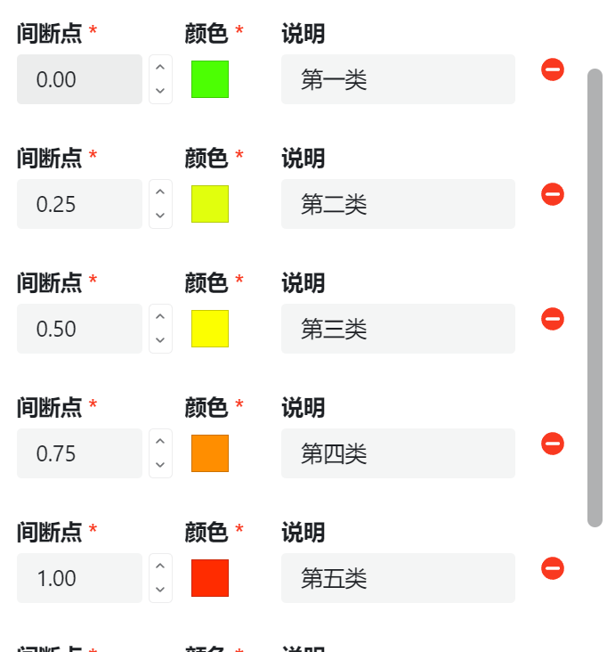

| 间断点 | 颜色 | 说明           |
| ------ | ---- | -------------- |
| 0.00   | 绿   | 第一类（很好） |
| 0.25   | 黄绿 | 第二类（好）   |
| 0.50   | 黄   | 第三类（较好） |
| 0.75   | 橙   | 第四类（较差） |
| 1.00   | 红   | 第五类（差）   |
| 1.25   | 深红 | 第六类（很差） |

得到的分类结果如下图

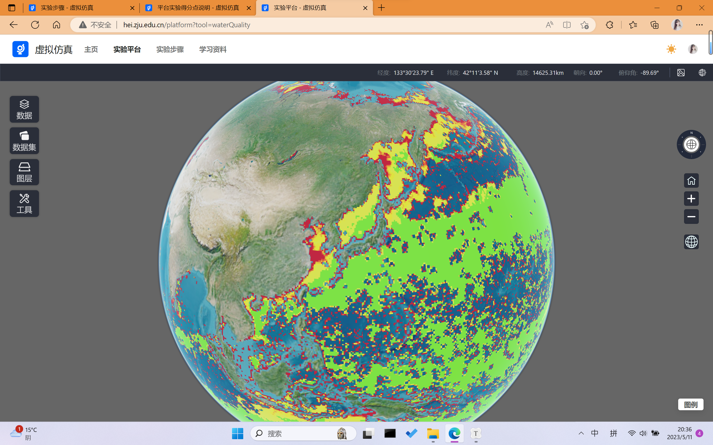

以我国渤海-黄海海域为例，使用【时序播放】功能，播放该区域水质情况。

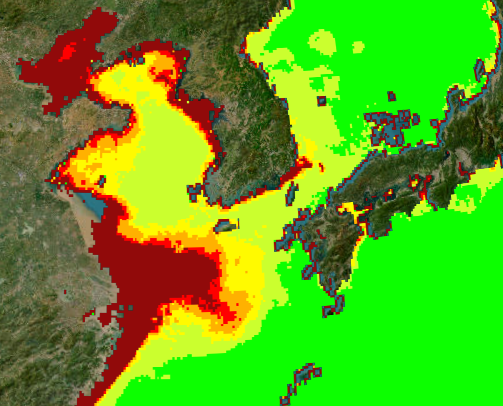

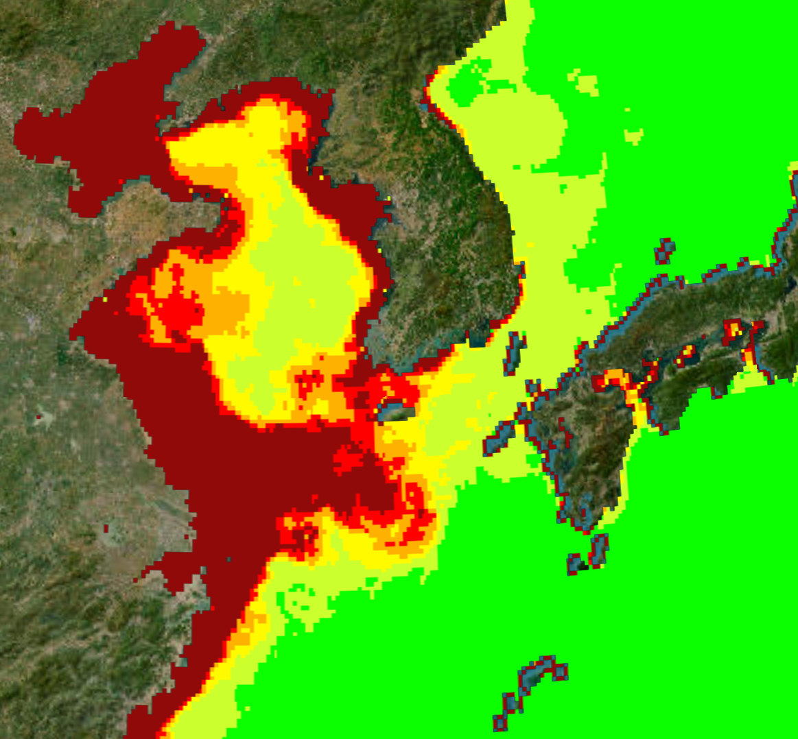

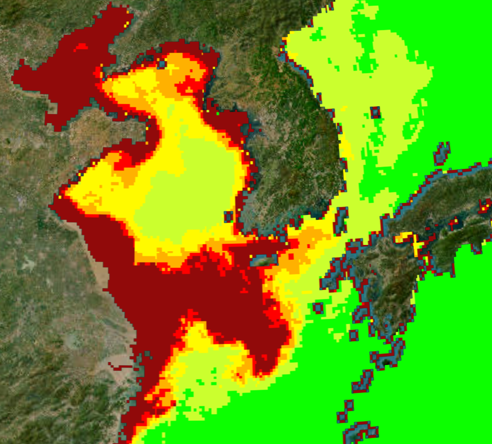

选择其中几个具有代表性的点位进行时间序列分析，得到的结果如下图

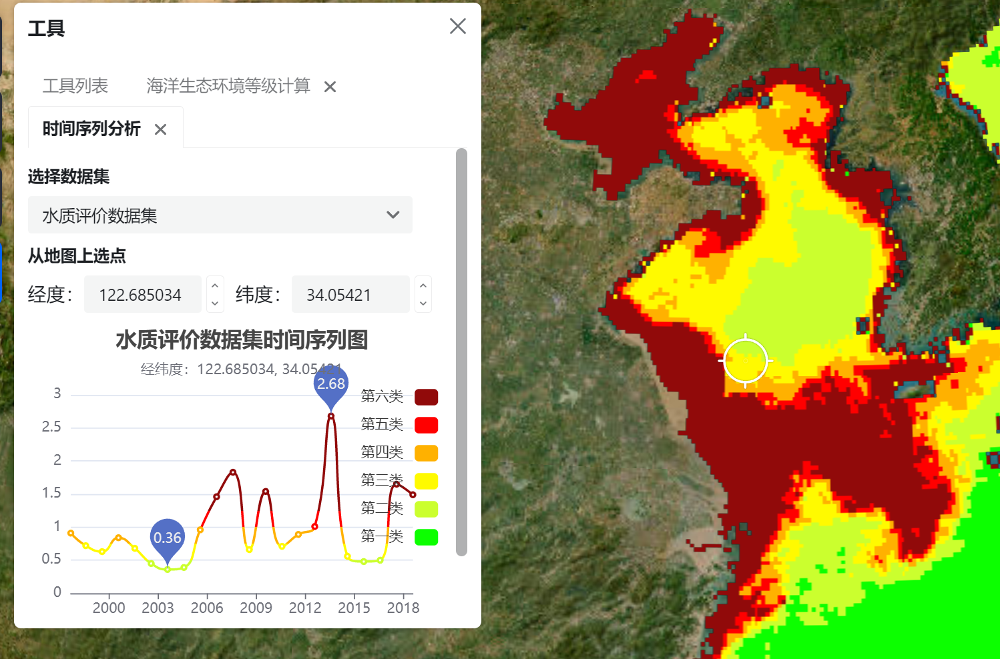

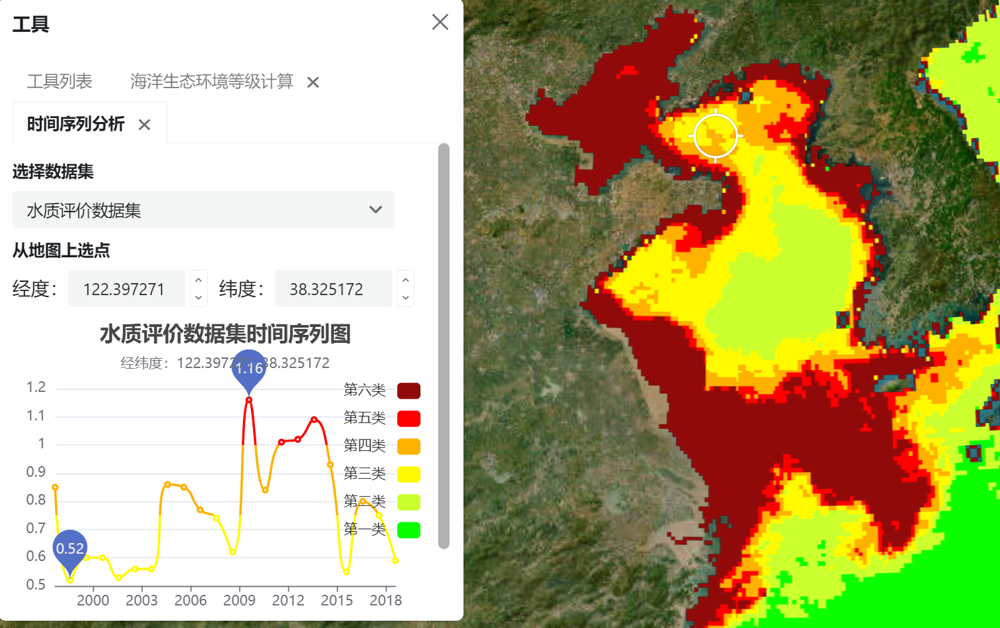

通过对渤海-黄海海域近30年内水质的时间序列分析，可以得出如下结论：

1. 渤海-黄海海域的水质普遍较差。有很多近岸区域的水质都是“极差”，且近年来水质日趋恶化，海域的水质等级普遍下降。
2. 越是靠近大陆的水域，其水质等级下降幅度越明显。这可能入海河流水质下降的影响导致的。
3. 绝大多数地区的水质条件偏差，在第4、5、6类的较多，远不如外海的水质条件

## 3.人类活动时空演变

### 3.1 长时序土地覆盖数据集检索和浏览

添加斐济地区土地覆盖数据集如下

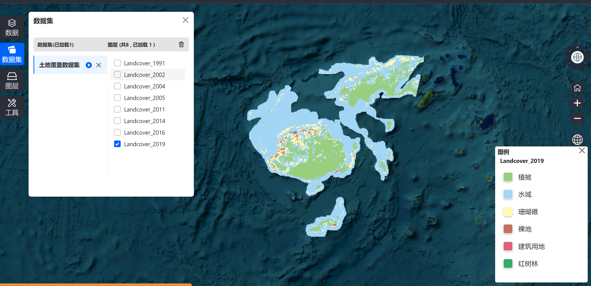

### 3.2 长时序土地覆盖时空演变过程模拟

使用【按时序播放】功能，进行土地覆盖数据集动图播放，如下图所示

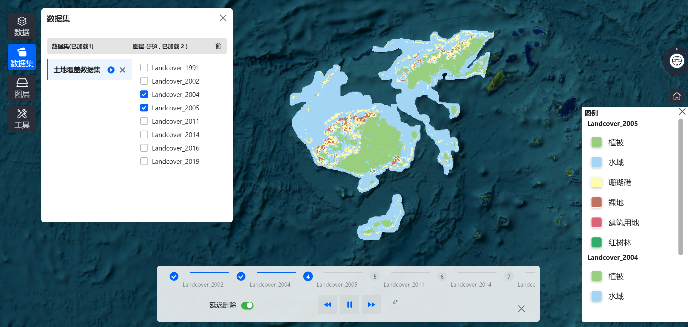

通过对上述图和动画的大致观察，可以得出如下初步结论：

1. 斐济的土地利用类型主要以水域为主，植被为辅，剩余地区绝大多数为裸地和珊瑚礁。其中植被主要集中在东南部和东北部；裸地主要集中在与植被相邻的近水位置。
2. 1991-2014年，植被和珊瑚礁所占的比例在减小；2014年之后，植被和珊瑚礁所占的比例有所扩大。2014年裸地的比例达到最大.

### 3.3 长时序土地覆盖统计信息图表绘制

为了对上述结论进行验证，需要绘制土地利用情况按时间变化的统计图。使用【土地利用分类】工具，绘制土地利用情况柱状图。参数设置如下

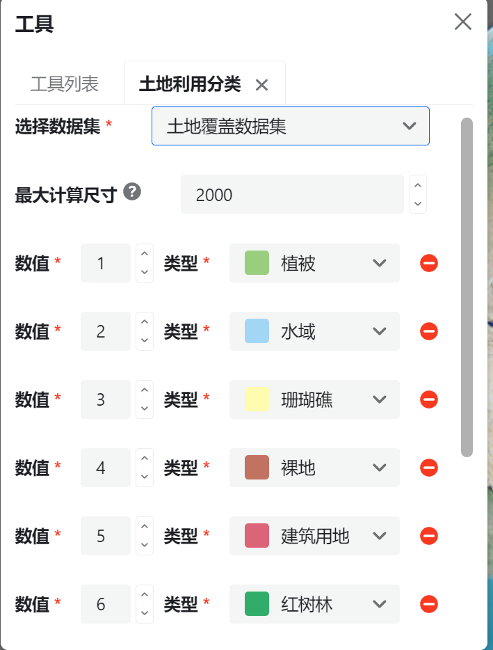

得到的结果如下

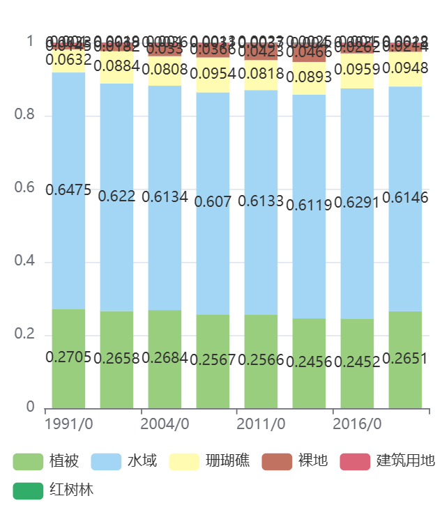

根据上述图表和土地利用时空演变动图，可以得出以下结论：

1. 斐济地区的土地覆盖以水域为主，其次是植被，非水域和植被的土地基本上以裸地和珊瑚礁为主。这主要和斐济地区的地形有关，如下图所示。可以看到，斐济作为南太平洋的一个岛国，其由多个岛屿构成。因此岛屿之间的领海地区就显示为水域。与此同时，斐济群岛的地形以山地丘陵为主，山地丘陵开发难度较大，故保留植被景观。近岸地区是适合人类居住的地区，这些地区由于人类的开发，原有的植被和红树林转变为裸地和建筑用地。大陆架地区以珊瑚礁为主，近年来随着珊瑚礁保护政策的实施，珊瑚礁覆盖率逐渐上升。

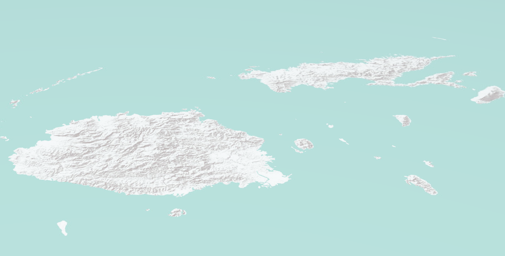

2. 从图中可以看到，水域面积基本上变化不大，植被覆盖面积以2014年为界，2014年之前逐渐减少，2014年之后逐渐增加；珊瑚礁所占面积始终呈现增加趋势。这可能是因为珊瑚礁保护政策一直在实施，而2014年之前斐济的开发力度较大，2014年之后考虑到植被保护等方面，采取了退耕还林、植树造林等措施使得植被面积有所恢复。
3. 斐济很多土地经历了一个从植被到裸地再到珊瑚礁地的过程。这可能是因为这些区域最初为植被，后来经过开发成为裸地或建筑物用地，最后随着海平面上升这些区域被淹没，转变为珊瑚礁用地。可见全球变暖和海平面上升对斐济地区的影响较大。

## 4.海平面上升模拟

### 4.1 全球平均温度-海平面模型

如下图所示，研究海平面上升对浙东北地区萧绍宁平原的影响。可以看到，输入上升温度1℃时，海平面将上升6.33m。

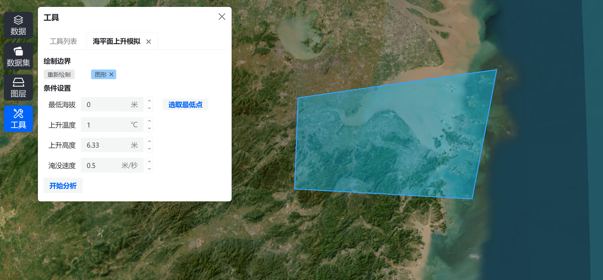

### 4.2 海平面变化过程仿真模拟

分别使温度上升1℃，5℃，10℃，15℃，模拟海平面上升的淹没过程如下图（下图为上升10℃的淹没结果）

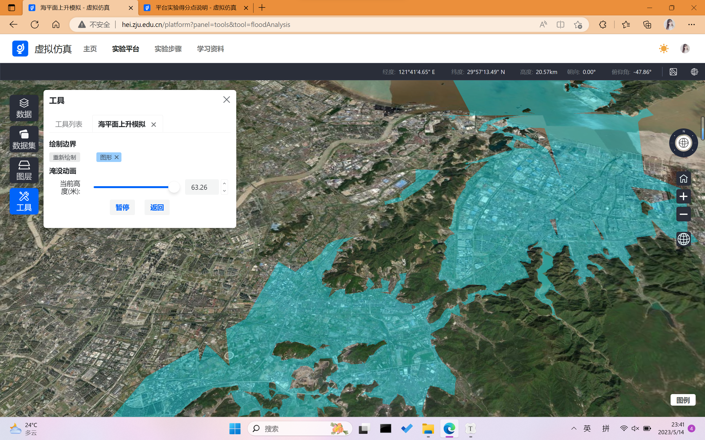

通过对不同温度下的海平面上升模拟分析，可以得出如下结论：

1. 全球气温升高会导致海平面上升，海平面上升后，最容易被淹没的是钱塘江沿岸湿地和洼地、甬江沿岸湿地洼地等地区
2. 当全球气温升高5℃时，基本上宁波-舟山港地区会全都被淹没，舟山群岛部分岛屿面积缩小，钱塘江下游杭州湾湿地和绍兴滨海新城会被淹没。而当全球气温升高10℃时，宁波整个北仑区和部分鄞州区都会被淹没，宁波-舟山港将不复存在，甚至相对远离海洋的杭州也会受到钱塘江涌潮的影响被淹没一部分。当全球气温升高15℃时，基本整个萧绍宁平原除山地丘陵地带之外其余所有地区都会被淹没。
3. 萧绍宁平原总体海拔较低，**上述模拟仅仅体现了海平面上升的影响，未考虑台风、涌潮等因素**。实际上淹没情况会比上述模拟的还要严重。故随着全球气温的升高，该地区需要特别重视海平面上升问题，及时加固堤坝，注意低洼地带的受淹情况。与此同时，减少碳排放，减缓温室效应也是每一个人应尽的义务。

## 5.碳通量时空过程仿真

### 5.1 海洋碳通量计算模型

加载全球碳通量数据集如下图

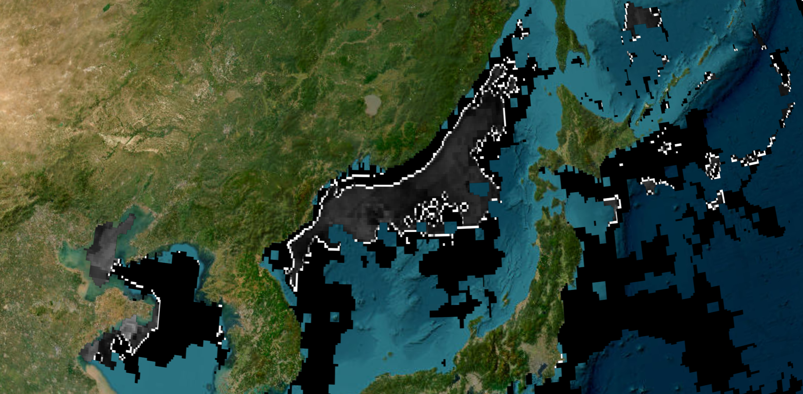

### 5.2 海洋碳循环时空演变过程模拟

使用【碳通量模拟】工具，设置合适参数，将碳通量可视化，如下图所示

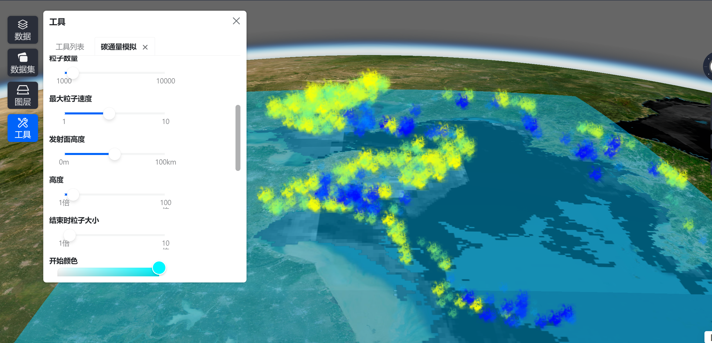

首先我们通过上述工具，对南北极地区、热带海洋、大西洋、印度洋等区域进行碳通量分析，得到结果如下：

1. 北极地区：北极地区是全球最敏感的海洋生态系统之一，其碳通量情况也非常特殊。由于海冰的融化和碳储存物的释放，北极地区的碳通量正在增加。此外，北极海域的生物多样性也受到了威胁。
2. 热带海洋：热带海洋的碳通量情况相对稳定。它们通常是碳的输入区域，因为它们的海洋生态系统生产了大量的有机物质，如珊瑚礁和海草床。然而，由于气候变化和环境污染等因素，热带海洋的碳通量正在发生变化。
3. 大西洋：大西洋是全球碳交换的重要地区之一。它是一个碳的输出区域，因为大西洋表面水中的碳含量高于下层水。此外，大西洋也是全球最大的热带风暴形成地之一，这些风暴会对碳通量产生影响。
4. 印度洋：印度洋的碳通量情况因地区而异。南部和东南部的海域是碳的输出区域，而北部和西部的海域则是碳的输入区域。印度洋的碳通量受季节性气候变化和海洋环流等因素影响。

再通过对南北极和我国近海岸等多个具有代表性的地区进行碳通量可视化分析，再结合有关数据和文献，大致可以得出如下结论：

1. 近年来，北极地区的海洋碳汇减少了，这可能是由于全球变暖导致的海冰减少和海洋酸化等环境因素造成的。同时，一些地区的海洋碳汇也在增加，例如南极洲周围的海域和热带海洋地区。这可能与海洋生态系统的变化有关，例如海洋生物的生长和死亡，以及海洋环境的变化。

2. 人类活动对海洋环境的影响主要来自化石燃料的燃烧、工业排放和农业活动等。这些活动会导致大量温室气体的排放，进而影响海洋的酸化和气候变化等环境问题。此外，过度捕捞、污染和海洋垃圾等问题也会对海洋生态系统造成影响。

3. 中国是全球最大的碳排放国之一，其碳通量情况非常严重。根据国际能源署（IEA）的数据，中国在2019年的二氧化碳排放量为10.17亿吨，占全球总排放量的28.8%。这个数字比排名第二的美国多出两倍以上。中国的碳通量主要来自于工业和能源部门的排放。工业部门的碳排放占全国总排放量的30%左右，能源部门的碳排放占总排放量的70%左右。由于中国是一个快速工业化和城市化的国家，其碳排放量在过去几十年中不断增加。

4. 中国的碳排放对海洋环境产生了多方面的影响：

   （1）海洋酸化：二氧化碳排放被大气和海洋吸收后，会导致海洋酸化。中国是全球最大的碳排放国之一，其排放量对海洋酸化的影响非常明显。海洋酸化会影响浮游生物和珊瑚等生态系统，对整个海洋生态系统的稳定性产生影响。

   （2）海平面上升：全球气温上升导致冰川融化和海水膨胀，加速了海平面上升的速度。中国的碳排放对全球气温上升产生了影响，因此也对海平面上升产生了贡献。海平面上升会引起海岸线的变化，影响岸线生态系统的稳定性。

   （3）影响海洋生物多样性：中国的海洋生物多样性受到了多种因素的影响，其中包括过度捕捞、污染和气候变化等。中国的碳排放对气候变化产生了影响，加剧了海洋生态系统的退化。这对中国的渔业和旅游业等相关产业产生了不利影响。

   （4）海洋酸雨：二氧化碳排放不仅会导致海洋酸化，还会产生酸雨。酸雨会对海洋生态系统中的生物造成直接伤害，例如海藻和贝类等。

## 6.实验小结

​       本次实验从海洋温度、海洋生态环境两个层面对近年来的海洋地理情况进行了统计分析和时间序列分析，得出近年来海洋水文特征和生态环境的变化趋势，并从人类活动时空演变、全球变暖、碳通量模拟等层面对这种变化趋势进行了原因分析与探索。通过实验，我了解到了近些年全球气候与环境的变化趋势和可能原因，提升了保护环境的意识。